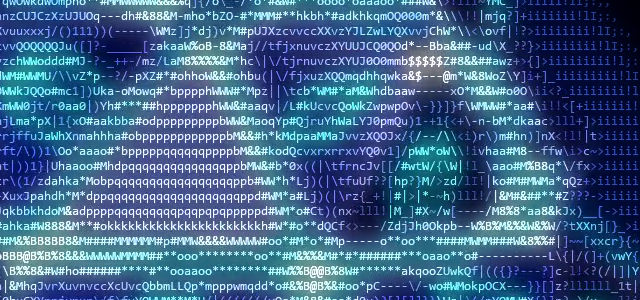

# ascii-player

Video and built-in 3D scenes as coloured ASCII art, from one Python file.


Up close, every pixel of it is a character:



There is no 3D engine and no shader. `ascii_player.py` builds the scenes as point clouds with
numpy, lights them, and picks a glyph and a colour for every cell from a ramp of 70 characters
plus `| / - \` for edges. Pillow draws the glyphs for the exported clip.

## What it does

- Plays any video file in the terminal as 24-bit coloured ASCII.
- Has two built-in 3D scenes:
  - **Hexcore**, the default: a polyhedron of rune pyramids with light in the gaps and
    lightning. The camera makes one full turn every 17 seconds.
  - **Bouquet**: flowers grow, bloom and are reborn, and the vase changes shape.
- Exports a vertical 1080×1920 clip: the ASCII art on top and, below it, this script's own
  code scrolling by in an editor window.

## Requirements

- Python 3.8 or newer
- numpy and Pillow: `pip install numpy pillow`
- ffmpeg on `PATH`, to read video files and to export. The built-in scenes play in the
  terminal without it.
- For export, a monospace font: Consolas, DejaVu Sans Mono, Menlo or Liberation Mono.

## Usage

```bash
python ascii_player.py                            # the Hexcore in the terminal
python ascii_player.py --scene bouquet            # the bouquet
python ascii_player.py clip.mp4                   # your own video in the terminal, looped
python ascii_player.py --export out.mp4           # a 17-second vertical clip of the scene
python ascii_player.py clip.mp4 --export out.mp4  # your video as a vertical clip
```

Press Ctrl+C to leave the terminal player. The terminal player fits the art to the window, so
a bigger window with a smaller font shows more detail.

| Option | Default | What it does |
| --- | --- | --- |
| `--scene hexcore\|bouquet` | `hexcore` | The built-in scene, when no video is given |
| `--export OUT.mp4` | | Write a vertical clip instead of playing in the terminal |
| `--seconds N` | 17 for a scene's clip | Duration |
| `--fps N` | 30 | Frames per second |
| `--cell N` | 7 | Glyph width in the clip, in pixels |
| `--cols N` | terminal width | Width in glyphs in the terminal |
| `--saturation X` | 1.5 | Colour saturation |
| `--code-speed X` | 6 | Code lines per second in the clip's editor window |
| `--no-color` | | Grey glyphs only |
| `--no-edges` | | No `\| / - \` edge glyphs |

## Licence

MIT. See [LICENSE](LICENSE).
